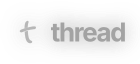
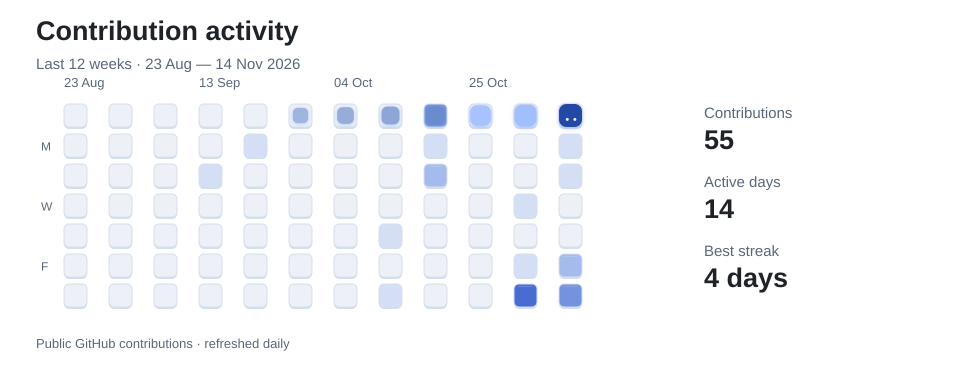

# hey, i'm ben.

> “Outwork your excuses.”

  

**[Thread](https://trythread.xyz)** — an AI companion for Mac and the web. [Source ↗](https://github.com/BenDevelops01/Thread)

<picture>
  <source media="(max-width: 600px) and (prefers-color-scheme: dark)" srcset="./assets/activity-dark-mobile.svg" />
  <source media="(max-width: 600px)" srcset="./assets/activity-light-mobile.svg" />
  <source media="(prefers-color-scheme: dark)" srcset="./assets/activity-dark.svg" />
  
</picture>

<!-- Social logos match the public site. Contribution activity refreshes daily from the public GitHub calendar. -->

