  <a href="https://bendevelops.vercel.app"><b>Portfolio ↗</b></a>
  &nbsp; / &nbsp;
  <a href="https://x.com/bennybuild5"><b>X · @bennybuild5 ↗</b></a>
  &nbsp; / &nbsp;
  <a href="https://trythread.xyz"><b>Thread ↗</b></a>
  &nbsp; / &nbsp;
  <a href="https://buymeacoffee.com/bendevelops"><b>Buy me a coffee ↗</b></a>

## Hey, I'm Ben.

I make things for the web and the desktop. This is where the ideas become commits.

Currently building **[Thread](https://trythread.xyz)** — an AI companion with a floating Mac buddy and a browser app. A little company for your next big idea.

### My commits, served fresh.

<picture>
  <source media="(prefers-color-scheme: dark)" srcset="https://raw.githubusercontent.com/BenDevelops01/BenDevelops01/main/assets/snake-dark.svg" />
  <source media="(prefers-color-scheme: light)" srcset="https://raw.githubusercontent.com/BenDevelops01/BenDevelops01/main/assets/snake-light.svg" />
  
</picture>

Real contributions. One hungry snake. Refreshed daily.

### Out of the .zip

**[Thread ↗](https://trythread.xyz)**  
Your AI, with a little personality. Meet the buddies, try the browser app, or explore the Mac beta.  
[Visit Thread](https://trythread.xyz) · [Explore the code](https://github.com/BenDevelops01/Thread)

**[My corner of the internet ↗](https://bendevelops.vercel.app)**  
The portfolio, the links, and whatever I'm making next.

---

Got an idea? **[Find me on X](https://x.com/bennybuild5).** Enjoy something I made? **[Fuel the next build ☕](https://buymeacoffee.com/bendevelops)**

build something. learn something. do it again.

