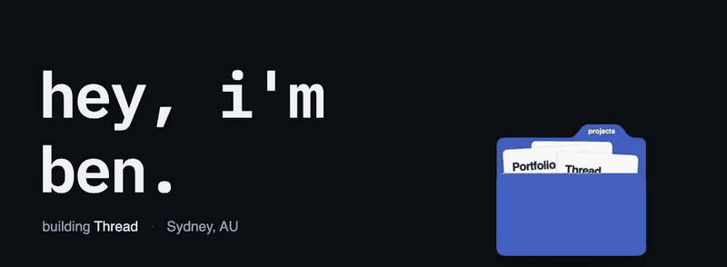
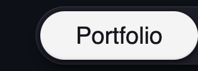
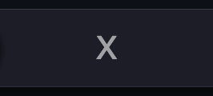
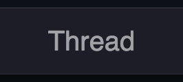
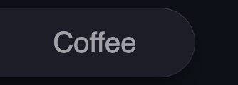

<a href="https://bendevelops.vercel.app">
  <picture>
    <source media="(prefers-reduced-motion: reduce)" srcset="./assets/profile-header.png" />
    
  </picture>
</a>

**[Thread](https://trythread.xyz)** — an AI companion for Mac and the web. [Source ↗](https://github.com/BenDevelops01/Thread)

### Contributions

<picture>
  <source media="(prefers-color-scheme: dark)" srcset="https://raw.githubusercontent.com/BenDevelops01/BenDevelops01/main/assets/snake-dark.svg" />
  <source media="(prefers-color-scheme: light)" srcset="https://raw.githubusercontent.com/BenDevelops01/BenDevelops01/main/assets/snake-light.svg" />
  
</picture>

<!-- Visuals rendered from React Bits Folder, Gooey Nav and Decrypted Text.
     React sources and third-party notices live in design/. -->
